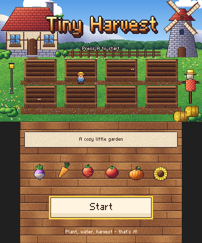
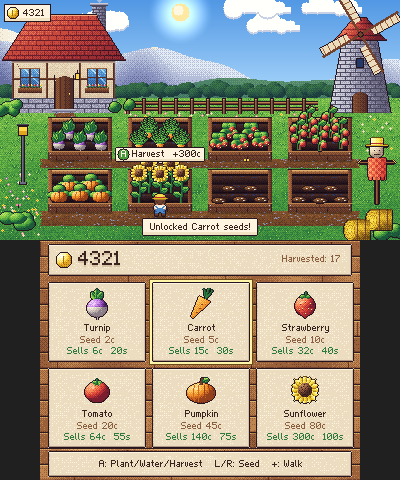
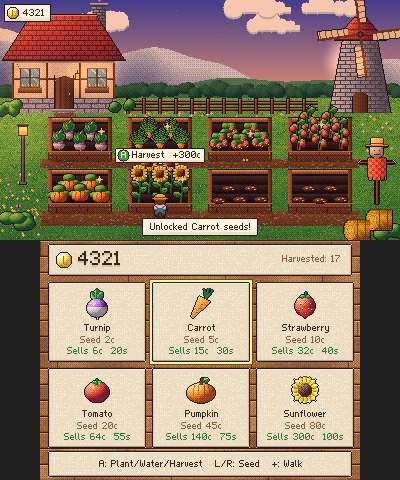
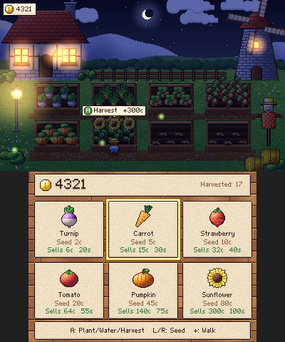

# Tiny Harvest 🌱

A super simple, cozy pixel-art farming game for the **Nintendo 3DS**.

Walk between eight planter beds, **plant**, **water** and **harvest** — one button does it all. Sell your harvest automatically, save up coins, and unlock new seeds, from quick turnips to towering sunflowers.

<p>


</p>
<p>


</p>

## How to play

1. Walk to a bed with the **D-Pad / Circle Pad**.
2. Press **A** to plant the selected seed.
3. Press **A** again to water it.
4. Wait a few seconds while it grows — then press **A** to harvest and earn coins.

A bubble above the bed always tells you what **A** will do. Pick seeds with **L / R** or by tapping a card on the touch screen. Tap the next locked card (or press **X**) to unlock it once you have enough coins. **START** pauses (music on/off, save & quit).

Every so often a rain shower waters the whole garden for you, and some harvests turn out **golden** — worth five times as much!

| Seed | Seed cost | Sells for | Grows in | Unlock |
| --- | --- | --- | --- | --- |
| Turnip | 2c | 6c | 20s | — |
| Carrot | 5c | 15c | 30s | 40c |
| Strawberry | 10c | 32c | 40s | 150c |
| Tomato | 20c | 64c | 55s | 400c |
| Pumpkin | 45c | 140c | 75s | 1000c |
| Sunflower | 80c | 300c | 100s | 2500c |

## The art

Everything is pixel art painted by code, in `tools/make_art.py`: a hand-composed farm scene (timber cottage, stone windmill, mountains, forest, scarecrow), shaded crops in five growth stages, a hand-pixelled farmer, planter beds, UI cards, icons, a custom proportional pixel font and the logo — all from one 107-colour palette with hue-shifted ramps, dithered shading and selective outlines.

On top of that the game adds live effects every frame: a day–night cycle (sunrise, sunset, starry nights with a moon), windows and lamps that glow after dark, fireflies, butterflies, drifting clouds, turning windmill sails, chimney smoke, crops swaying in the wind, rain showers, sparkles and harvest pops. Chiptune music (a day and a night theme) and sound effects are synthesized in real time.

Regenerate the art after editing the script:

```sh
python3 tools/make_art.py   # writes source/art.c, source/art.h, cia/banner.png, icon.png
```

## Installing on a 3DS

You need a 3DS with custom firmware (Luma3DS).

### Install the .cia with FBI (recommended)


1. Connect your 3DS to Wi-Fi and open **FBI**.
2. Go to **Remote Install → Scan QR Code** and point the camera at the code above.
3. Confirm the install. **Tiny Harvest** appears on your HOME Menu.

The QR code links to
`https://github.com/Dipish3639/farming-game-3ds/releases/download/latest-build/pixelfarm.cia`,
which always serves the newest build. You can also download it from the
[**latest-build** release](https://github.com/Dipish3639/farming-game-3ds/releases/tag/latest-build)
and install it from FBI's file browser, or copy `pixelfarm.3dsx` to `sdmc:/3ds/` and use the Homebrew Launcher.

> **No sound?** Homebrew audio needs the DSP firmware dumped once: open the Rosalina menu (L + D-Pad Down + Select) → *Miscellaneous options* → *Dump DSP firmware*, then restart the game.

## Building

Install [devkitPro](https://devkitpro.org/wiki/Getting_Started) with the `3ds-dev` package group, then:

```sh
make                                   # pixelfarm.3dsx
cia/build_cia.sh makerom bannertool    # pixelfarm.cia (needs makerom and bannertool)
```

Or with Docker: `docker run --rm -v "$PWD":/src -w /src devkitpro/devkitarm make`

The game code doesn't depend on the 3DS, so it also runs on a PC. `tools/pc_sim.c` plays the game with button presses (planting, watering, harvesting, unlocking seeds, pausing, saving), checks everything works, and writes screenshots plus a WAV of the audio:

```sh
cc -O2 -Isource source/game.c source/gfx.c source/art.c source/audio.c tools/pc_sim.c -lm -o pc_sim
mkdir -p shots && ./pc_sim shots
```

| File | What's in it |
| --- | --- |
| `source/game.c` | The game: beds, farmer, growing, coins, day/night, weather, rendering |
| `source/gfx.c` | Software renderer: palette-tinted art, glows, sway, pixel font |
| `source/audio.c` | Chiptune synthesizer: music sequencer and sound effects |
| `source/art.c` | Generated art data (do not edit by hand) |
| `source/main_3ds.c` | 3DS entry point: input, framebuffers, DSP audio |
| `tools/make_art.py` | Paints all the art |
| `cia/` | `.cia` packaging: makerom settings, HOME Menu banner + jingle, FBI QR code |
