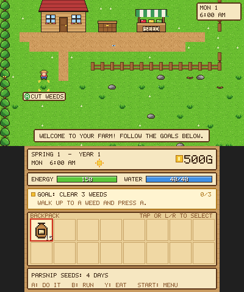
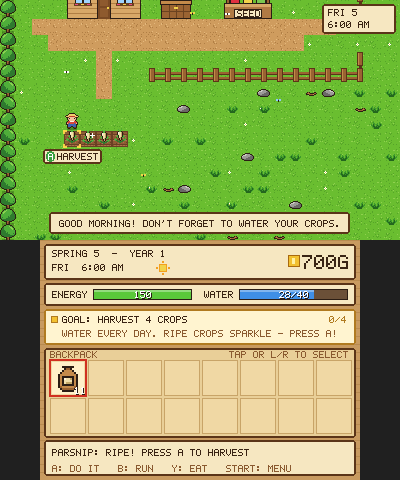
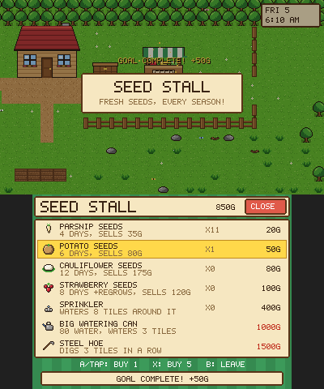

# Pixel Farm 🌱

A cozy pixel-art farming game for the **Nintendo 3DS**, inspired by Stardew Valley — but just the farming.

Clear your overgrown land, dig the soil, plant seeds, water them every day and ship your harvest for gold. Built-in goals walk you through everything, and the A button always does the right thing for whatever is in front of you.

<p>



</p>

## Features

- **One-button farming** — walk up to anything and press **A**: cut weeds, break stones, dig, plant, water, harvest, refill the can, ship, shop or sleep. A bubble above the tile tells you what A will do. **Hold A** to keep working.
- **Guided goals** — a goal panel and a bouncing arrow lead you from your first weed to your first harvest and beyond, with gold rewards.
- **Clear crop feedback** — thirsty crops show a water drop, ripe crops bob and sparkle, and the touch screen tells you how many days are left.
- **Music and sound** — a bouncy daytime tune, a dreamy night theme, and sound effects for every action (all synthesized in real time).
- **12 crops across 4 seasons**, some regrow after harvest
- **Day/night cycle** with lit windows and fireflies, **seasons** that recolour the farm, **rain** that waters for you, and **snow** in winter
- **Seed Stall** with seasonal seeds, sprinklers and tool upgrades (Big Watering Can, Steel Hoe)
- **Shipping bin** with a nightly shipping report
- Particles, floating text, butterflies and falling leaves
- Autosaves every night to `sdmc:/3ds/pixelfarm/save.dat`

## Controls

| Button | Action |
| --- | --- |
| Circle Pad / D-Pad | Move |
| Hold B | Run |
| A | Do whatever the prompt says (hold to repeat) |
| L / R or tap the backpack | Choose which seeds to plant / item to use |
| Y | Eat the selected crop for energy |
| START | Menu: How to Play, music on/off, save, quit |

> **No sound?** The 3DS needs its DSP firmware dumped once for homebrew audio: run **DSP1** (or Luma3DS's *Dump DSP firmware* option in the Rosalina menu). The game still runs fine without it.

## Installing on a 3DS

You need a 3DS with custom firmware (Luma3DS).

### Install the .cia with FBI (recommended)


1. Connect your 3DS to Wi-Fi and open **FBI**.
2. Go to **Remote Install → Scan QR Code** and point the camera at the code above.
3. Confirm the install. **Pixel Farm** appears on your HOME Menu.

The QR code links to
`https://github.com/Dipish3639/farming-game-3ds/releases/download/latest-build/pixelfarm.cia`,
which always serves the newest build of the default branch. You can also download `pixelfarm.cia` from the
[**latest-build** release](https://github.com/Dipish3639/farming-game-3ds/releases/tag/latest-build),
copy it to your SD card, and install it from FBI's file browser.

### Or run the .3dsx from the Homebrew Launcher

Copy `pixelfarm.3dsx` from the same release to `sdmc:/3ds/` and launch it from the Homebrew Launcher.
It also runs in 3DS emulators (e.g. Azahar / Lime3DS / Citra).

## Building

Install [devkitPro](https://devkitpro.org/wiki/Getting_Started) with the `3ds-dev` package group, then:

```sh
make                                   # pixelfarm.3dsx
cia/build_cia.sh makerom bannertool    # pixelfarm.cia (needs makerom and bannertool)
```

Or with Docker:

```sh
docker run --rm -v "$PWD":/src -w /src devkitpro/devkitarm make
```

## How it's made

Everything is drawn with a small software renderer (`source/gfx.c`) into plain pixel buffers which are copied to the 3DS framebuffers each frame — no image assets needed. All pixel art lives as text grids in `source/sprites.c`, recoloured per crop and per season.

Because the game code doesn't depend on the 3DS, it can also run on a PC. `tools/pc_sim.c` plays through the whole tutorial using button presses only, the way a player would — following the goals from the first weed to buying seeds — checks every goal completes, and writes screenshots plus a WAV of all the game's audio:

```sh
cc -O2 -Isource source/game.c source/gfx.c source/sprites.c source/data.c source/audio.c tools/pc_sim.c -lm -o pc_sim
mkdir -p shots && ./pc_sim shots
```

| File | What's in it |
| --- | --- |
| `source/main_3ds.c` | 3DS entry point: input, framebuffer output |
| `source/game.c` | Game state, farming rules, day cycle, shop, save/load, rendering |
| `source/sprites.c` | Pixel art and procedurally generated ground tiles |
| `source/data.c` | Crop table and item names |
| `source/audio.c` | Chiptune synthesizer: music sequencer and sound effects |
| `source/gfx.c` | Software renderer and 5×7 pixel font |
| `cia/` | `.cia` packaging: makerom settings, HOME Menu banner + jingle, FBI QR code |
